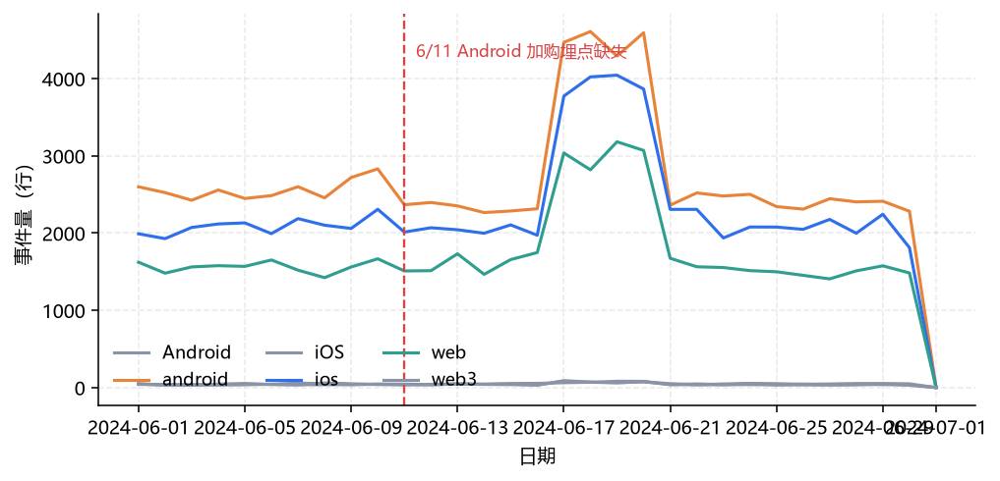
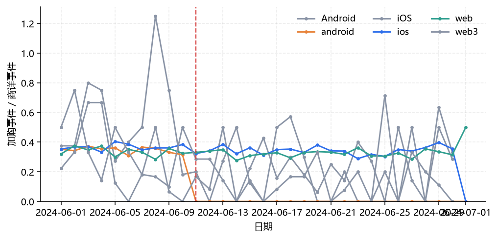
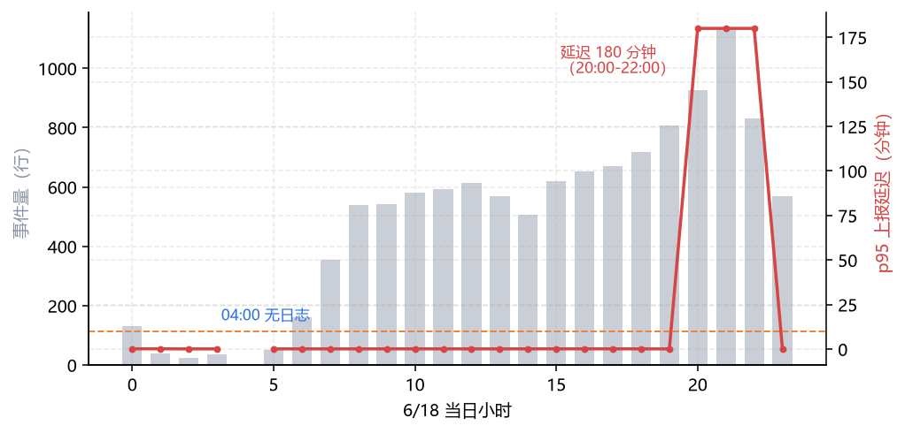

# 埋点数据质量监控与影响面回溯 · 分析报告

> 项目：`tracking-quality`　｜　运行：`python scripts/run_all.py`
> 全部数字由仓库代码生成，`outputs/metrics.json` 可逐项核对。

---

## 摘要

一次发版漏传参数，让 Android 端的「加购」埋点整段消失了 20 天。数据侧没有任何报错，
报表照常出，结论是「加购率从 35% 跌到 0%」——如果按这个数字做决策，会去优化一个根本没坏的页面。

本项目把这类问题做成每日可跑的检查：

1. **六条规则覆盖六类缺陷**，全部命中注入的缺陷，行级 / 会话级 / 设备级 precision 与 recall 都是 1.00。
2. **影响面能量化**：全站加购率观测值 24.35%，校正后 34.24%，被低估 **9.88 个百分点（相对 40.6%）**。
3. **误报被专门治理**：R1 的基线从「中位数 + MAD」改成「90 分位 + 业务阈值」，因为前者在异常持续 20 天后会完全失效。

---

## 一、数据来源与设计

### 1.1 为什么必须造数据

验证质检规则的前提是**知道哪些行是坏的**。公开数据集没有带缺陷标记的埋点日志，
所以 `src/generate.py` 先造一份正常日志，再按剧本注入缺陷，剧本落到 `outputs/ground_truth.json`。
规则引擎读不到这份真值，只在评估环节使用。

| 维度 | 设定 |
|---|---|
| 规模 | 208,217 行 / 7,883 用户 / 59,999 会话 / 2024-06-01 起 31 天 |
| 漏斗 | view（每会话 1~4 次）→ detail 58% → add_to_cart 34% → order 42% |
| 平台 | iOS 34% / Android 41% / Web 25% |
| 日活曲线 | 双峰（午休、晚间），618 期间会话量 ×1.9 |

### 1.2 注入的缺陷

| 编号 | 缺陷 | 注入方式 | 规模 |
|---|---|---|---|
| D1 | 漏埋 | Android 端 `add_to_cart` 自 6/11 整段删除 | 3,404 行 |
| D2 | 重复上报 | 5% 行复制一份，`event_id` 相同、`server_time` +2s | 9,915 行 |
| D3a | 延迟 | 6/18 20:00-22:00 的 `server_time` 后移 3 小时 | 2,770 行 |
| D3b | 断点 | 6/18 04:00 整点数据删除 | 8 行 |
| D4 | 顺序倒挂 | 3% 订单的 `event_time` 前移 2 小时 | 150 行 |
| D5 | 字段异常 | 2% 平台值改为 `Android`/`iOS `/`web3`；1% 订单金额改为 -1/0 | 4,212 行 |
| D6 | 设备复用 | 1% 会话的 `device_id` 换成其他用户的设备 | 580 台设备 |

### 1.3 字段说明

见 README「字段说明」表。要点：`flag_*` 系列是注入标记，**规则代码中不允许出现**，
否则就是拿答案做题；`tests/test_rules.py` 里的用例也不构造这些列。

---

## 二、清洗与检查

原始日志不做任何清洗就进规则引擎——清洗会掩盖问题。检查顺序上有个讲究：

1. **先查唯一性，但不要先删重复**。如果先 `drop_duplicates`，R2 就永远查不出东西了。
   所以规则引擎跑在原始表上，去重只在影响面估算时做。
2. **延迟不按行判**。客户端时钟不准会造成假延迟（D4 就是这么注入的），逐行判定误报会很高。
   R3 只看「整点 p95」，用聚合把偶发抖动抹掉。
3. **断点要排除本来就没人来的时段**。凌晨 3 点没有日志是正常的，一律按 `n==0` 判会把每天的低谷报成故障。

---

## 三、探索分析

Android 的事件总量在 6/11 之后没有明显下跌——因为它只丢了「加购」这一个事件，
占该端总量的 8% 左右。**只看总量曲线是发现不了这个问题的**，这是埋点监控最容易踩的坑：
总量正常不代表链路正常。

换成「加购事件 / 商详事件」的比值，Android 在 6/11 直接从 0.359 掉到 0——断崖非常干净。
这个比值把「流量波动」约掉了，只留下转化结构的变化。

6/18 有两个独立问题：20:00-22:00 的 p95 延迟到 180 分钟（上报管道积压），04:00 完全没有数据（断流）。

---

## 四、方法：六条规则

| 规则 | 判定逻辑 | 阈值 | 为什么这么定 |
|---|---|---|---|
| R1 完整性 | 各端「加购/商详」比值 vs 90 分位基线 | 跌破 40% | 见下文 |
| R2 唯一性 | `event_id` 重复率 | 1% | SDK 重试通常 2%~8%，1% 是噪声上限 |
| R3 及时性 | 整点 p95 延迟；整点断流（排除低峰时段） | p95 > 600s | 实时看板的容忍上限是 10 分钟 |
| R4 一致性 | 会话内 order 时间早于 detail 的比例 | 0.5% | 时钟漂移通常 <0.1% |
| R5 有效性 | 枚举白名单、金额 > 0 | 0.5% | 上游系统改造会带来千分级异常 |
| R6 设备一致性 | 一设备多用户，按受影响会话占比 | 1% | 家庭共用设备约 1%~2% 属正常 |

### R1 的基线选择：一次真实的翻车

第一版用「中位数 + MAD」的稳健 z 值（阈值 |z| > 3.5）。结果**整段缺失没被检出来**：

- 30 天里 20 天比值为 0、10 天为 0.35
- 中位数 = 0，MAD = 0
- z = 0.6745 × (0 - 0) / 1e-9 = 0，永远不触发

结论：**当异常持续得足够久，它就成了「正常」**。任何以中位数为基线的检测方法，
在异常占比超过 50% 时都会失效。改用 90 分位（代表健康水平）后，检出恢复正常。

第二版还遇到了小样本误报：窗口最后一天只剩几十个会话，比值随机波动被判成异常。
加了「平台日商详量 ≥ 200 才参与判定」的样本量门槛后，误报消失。

### 评估粒度：不能一律按行算

| 缺陷 | 粒度 | 原因 |
|---|---|---|
| 重复上报 | event_id | 两条记录 ID 相同，「哪条是副本」永远无法判断，行级 P/R 没有意义 |
| 顺序倒挂 | session_id | 天生是会话级现象 |
| 设备复用 | device_id | 天生是设备级现象 |
| 字段异常 | row | 可以直接按行判定 |

**缺陷的可检测粒度不同，评估口径就该不同**——否则会得出「重复上报检出率只有 50%」这种假结论。

---

## 五、结果

### 5.1 规则命中情况

六条规则在 31 天日志上全部 `fail`，与注入清单逐条对应：

| 规则 | 输出 |
|---|---|
| R1 | android 端自 2024-06-11 起比值 0.359 → 0.000（跌幅 100%），20 个平台日触发，同期商详 10,302 行 |
| R2 | 9,915 行重复，去重后 198,302 行（4.76%） |
| R3 | 4 个整点 p95 超 600s（最高 10,800s）；1 个整点断流 |
| R4 | 150 个会话倒挂（3.0%） |
| R5 | 平台非法 4,160 行；金额非正 52 行；设备号缺失 7.8% |
| R6 | 580 台设备多用户，波及 4,634 个会话（7.7%） |

### 5.2 检出质量

| 缺陷 | 注入 | 检出 | Precision | Recall |
|---|---:|---:|---:|---:|
| D2 重复上报 | 9,915 | 9,915 | 1.000 | 1.000 |
| D4 顺序倒挂 | 150 | 150 | 1.000 | 1.000 |
| D5 字段异常 | 4,212 | 4,212 | 1.000 | 1.000 |
| D6 设备复用 | 580 | 580 | 1.000 | 1.000 |

### 5.3 影响面

| 指标 | 观测值 | 校正值 | 偏差 | 方向 |
|---|---:|---:|---:|---|
| 全站加购率 | 24.35% | 34.24% | -9.88 pp | 低估 |
| GMV | 615,076 元 | 620,248 元 | -0.8% | 低估 |
| 事件量 PV | 208,217 | 198,302 | +5.0% | 高估 |

**加购率低估 9.88 个百分点**是本项目最重要的产出。校正方法是：用 Android 端 6/1~6/10 的
自身比值（0.350）乘 6/11 之后的商详会话数（9,821），补回 3,435 个缺失加购会话。
这是外推，不是测量——报告里必须标明，否则就是把估计当事实。

GMV 只差 0.8%，是因为金额非法只有 52 笔；这提醒了一件事：**同一个指标体系里，
不同缺陷的影响量级可以差两个数量级**，排优先级要看影响面而不是看告警条数。

---

## 六、结论与建议

**给数据团队**：

1. 埋点监控要盯「比值」而不是「总量」。总量正常、链路已断，是这类问题最典型的形态。
2. 每条规则必须给出「哪个端、哪个事件、从哪天、影响多少行」，只报异常等于没报。
3. 规则上线后要持续跟踪误报率。误报两次以上，业务方就不看告警了。

**给业务方**：

1. 看到「加购率断崖」先查埋点，再查体验。这次是埋点问题，不是产品问题。
2. 大促前做一次全链路埋点回归，成本远低于事后补数。

## 七、局限

| 局限 | 说明 |
|---|---|
| 数据是生成的 | 真实日志还有改数、跨端 ID 不一致、本地缓存丢包等问题，这里只覆盖 6 类 |
| 影响面是估算 | 加购率校正依赖「缺陷前后转化率稳定」，若同期有活动会偏 |
| 只到整点粒度 | 分钟级断流会漏掉 |
| 没有根因定位 | 能定位到端与事件，但分不清是发版漏传、参数改名还是网关丢包 |
